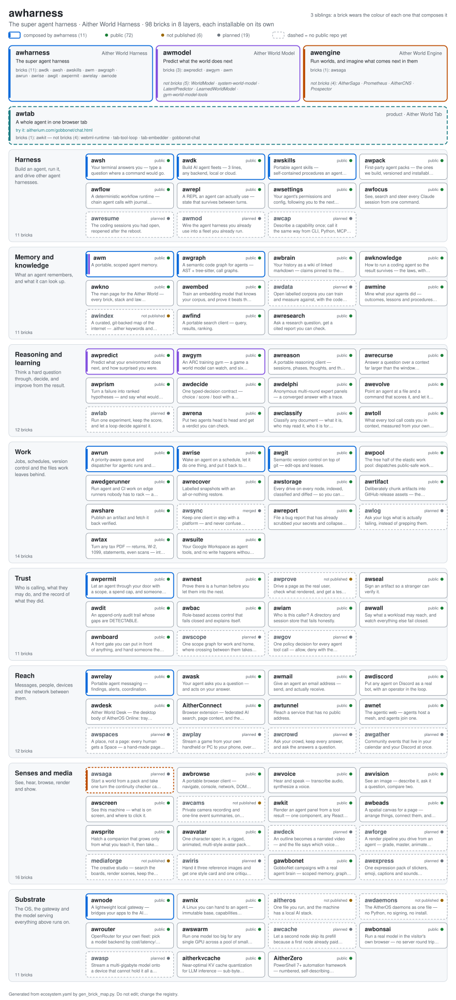

# awharness — the brick map

<!-- GENERATED by AitherOS/dev/tools/gen_brick_map.py from AitherOS/config/ecosystem.yaml. Edits here are overwritten; change the registry and run `gen_ecosystem.py --emit --map`. -->

**`awharness`** — the super agent harness. One name for the kit, the shell and the bricks an agent works with, taken together. It is a harness that sits above other harnesses: the shell drives Claude Code, Codex and the rest as real products, and the bricks give every one of them the same memory, jobs, leases, permits and tools.

- **Today:** There is no single install. `pip install awdk` and `npm i -g @aitherium/awsh` are two commands, and each other brick installs on its own line. `adk harness parts` reads this list and reports which parts this machine has, at what version, and the install line for each one it lacks.
- **Planned, not built:** One install command that brings the composed bricks up together, and one process that starts them. Neither exists; nothing by this name is published.
- **Composed (11, bold below):** `awdk` `awsh` `awskills` `awm` `awgraph` `awrun` `awrise` `awgit` `awpermit` `awrelay` `awnode`

Check this machine: `adk harness parts`.

<picture>
  <source media="(prefers-color-scheme: dark)" srcset="brick-map-dark.svg">
  
</picture>

## The family

Three names, one for each job. Each is a grouping of pieces that exist on their own; none is a package, and a member that is not a brick is a service or code inside the platform, with nothing to install.

| name | reads as | what it does | bricks it composes | members that are not bricks |
|---|---|---|---|---|
| **`awharness`** | Aither World Harness | The super agent harness | `awdk` `awsh` `awskills` `awm` `awgraph` `awrun` `awrise` `awgit` `awpermit` `awrelay` `awnode` | — |
| **`awmodel`** | Aither World Model | Predict what the world does next | `awpredict` `awgym` `awm` | `WorldModel` (service) · `system-world-model` (library) · `LatentPredictor` (library) · `LearnedWorldModel` (library) · `gym-world-model-tools` (tools) |
| **`awengine`** | Aither World Engine | Run worlds, and imagine what comes next in them | `awsaga` | `AitherSaga` (service) · `Prometheus` (service) · `AitherCNS` (service) · `Prospector` (module) |

**`awmodel`** — The pieces that predict what an environment does next and score how wrong the prediction was. An agent run by the harness asks it before acting; a world run by the engine is one of the things it is asked about.

- **Today:** One installable brick sits at the centre: `awpredict` (a JEPA-style latent predictor and a lighter transition model, with a lookup table to beat). `awgym` is a game it can watch, and `awm` predicts an action's outcome from remembered state. The other parts are code inside the platform, not packages: a belief graph over fleet events, a model of the platform's own services, and two learned predictors used by the planner. They are separate models; nothing joins them into one.
- **Planned, not built:** One model the parts share, and one command that asks it. Neither exists; nothing by this name is published.
- **Start here:** `awpredict engines`
- **`awm` is also composed by another sibling, on purpose:** Memory is composed by the harness, and its `awm_world_state` and `awm_predict` tools encode remembered state and predict an action's outcome from it, which is this grouping's job too.
- `WorldModel` (service, not a brick): One belief graph over fleet events — entities, relations and what is expected next.
- `system-world-model` (library, not a brick): A model of the platform itself — which services are about to fail, and what happens if one does.
- `LatentPredictor` (library, not a brick): A JEPA-style latent predictor that records the transitions that surprised it.
- `LearnedWorldModel` (library, not a brick): A small neural transition predictor for the planner, with a lookup table until it has seen enough.
- `gym-world-model-tools` (tools, not a brick): The gym's model as tools — encode a grid, predict the next one, score the surprise, train.

**`awengine`** — The pieces that run a world: a story takes a turn a checker can refuse, a simulation advances by a tick, and the platform's own senses are rolled forward as a dream. The harness runs the agents that live in these worlds; the model is what predicts them.

- **Today:** One brick, `awsaga`, is registered and not yet installable. The rest are fleet services, not packages: AitherSaga keeps story projects and turns, Prometheus is the tick-based world simulation (not the metrics product, which is a different service), AitherCNS fuses the platform's senses into one state and rolls it forward, and Prospector is a failure-forecast head inside AitherCNS. AitherCNS and Prospector are off unless switched on. Each runs on its own; there is no single engine process, and `saga_continuity_check` is a gateway tool, not a command a stranger can install.
- **Planned, not built:** One engine a world pack starts, with the simulation and the imagination behind one door. Neither exists; nothing by this name is published.
- **Start here:** `saga_continuity_check`
- `AitherSaga` (service, not a brick): Story projects, characters, places and turns, with a continuity check.
- `Prometheus` (service, not a brick): The world simulation — lives, factions, economy and weather, advanced tick by tick.
- `AitherCNS` (service, not a brick): Fuses the platform's senses into one state and rolls it forward — digest, imagine, dream.
- `Prospector` (module, not a brick): A failure-forecast head inside AitherCNS — what the fleet's telemetry is imagined to do next.

## Products

Something a person opens and uses, built from the bricks below. A product is not a fourth sibling of the family, and it does not colour the bricks it composes; on the map it is the dashed card under the family.

| product | reads as | what it is | try it | page |
|---|---|---|---|---|
| **`awtab`** | Aither World Tab | A whole agent in one browser tab | [aitherium.com/gobbonet/chat.html](https://aitherium.com/gobbonet/chat.html) | [https://aitherium.com/awtab](https://aitherium.com/awtab) |

**`awtab`** — One browser tab runs a 1-bit language model on the visitor's GPU through WebGPU, a tool-calling agent loop and an on-device embedder. There is no inference server: the model, the tools and the search all run inside the tab.

- **Today:** Live in a WebGPU browser at aitherium.com/gobbonet/chat.html. Two model sizes from PrismML's Bonsai family (1.7B and 4B) download once and the browser caches them; the tools run in a worker inside the tab. It has been measured on one GPU class only.
- **Planned, not built:** Reloading with no network, the smaller 384-d embedder in the tab, and measurements on more than one class of GPU. None of these is done yet. awtab is a page, not a package: nothing by this name is on npm or PyPI.
- **Claim, checked 2026-11-13:** As of 13 November 2026 we found no other browser stack that runs a 1-bit model, a tool-calling agent loop and an on-device embedder together in one tab, with no inference server.
- **Limit:** It needs a browser with WebGPU and a GPU it can use.
- **Limit:** The first load downloads 248 MB (1.7B) to 572 MB (4B) before the first answer; after that the browser cache serves it.
- **Limit:** Search downloads its embedder (the 1024-d one) the first time it is used.
- **Limit:** Measured on one GPU class only, and reloading with no network has not been tested.
- **Built from:** `awkit`; not bricks: `webml-runtime` (library) · `tab-tool-loop` (library) · `tab-embedder` (module) · `gobbonet-chat` (module)
- `webml-runtime` (library, not a brick): Runs the 1-bit model on the visitor's GPU through WebGPU. Proprietary, and withheld from the public awkit package.
- `tab-tool-loop` (library, not a brick): The agent loop in the tab — the model asks for a tool, a worker runs it, the answer goes back to the model.
- `tab-embedder` (module, not a brick): Turns text into vectors on the visitor's GPU, inside the tab, so search needs no embedding server.
- `gobbonet-chat` (module, not a brick): The chat page people open, wired to the model, the tools and the embedder in the tab.

Boxes with a solid outline have a public repository; a dashed outline means none yet. A coloured outline marks a brick the umbrella or one of its siblings composes, in the colour of that sibling's card; a brick composed by two has a bar in each colour. In the image the boxes are not clickable (GitHub shows SVG as an image); open [brick-map-light.svg](brick-map-light.svg) or [brick-map-dark.svg](brick-map-dark.svg) directly, or use the tables.

## Layers

| layer | what it is for | bricks |
|---|---|---|
| **Harness** | Build an agent, run it, and drive other agent harnesses. | [**awsh**](https://github.com/Aitherium/awsh) · [**awdk**](https://github.com/Aitherium/awdk) · [**awskills**](https://github.com/Aitherium/awskills) · [awpack](https://github.com/Aitherium/awpack) · [awflow](https://github.com/Aitherium/awflow) · [awrepl](https://github.com/Aitherium/awrepl) · [awsettings](https://github.com/Aitherium/awsettings) · [awfocus](https://github.com/Aitherium/awfocus) · awresume *(planned)* · awmod *(planned)* · awcap *(planned)* |
| **Memory and knowledge** | What an agent remembers, and what it can look up. | [**awm**](https://github.com/Aitherium/awm) · [**awgraph**](https://github.com/Aitherium/awgraph) · [awbrain](https://github.com/Aitherium/awbrain) · [awknowledge](https://github.com/Aitherium/awknowledge) · [awkno](https://github.com/Aitherium/awkno) · [awembed](https://github.com/Aitherium/awembed) · awdata *(planned)* · [awmine](https://github.com/Aitherium/awmine) · awindex *(not published)* · [awfind](https://github.com/Aitherium/awfind) · [awresearch](https://github.com/Aitherium/awresearch) |
| **Reasoning and learning** | Think a hard question through, decide, and improve from the result. | [**awpredict**](https://github.com/Aitherium/awpredict) · [**awgym**](https://github.com/Aitherium/awgym) · [awreason](https://github.com/Aitherium/awreason) · [awrecurse](https://github.com/Aitherium/awrecurse) · [awprism](https://github.com/Aitherium/awprism) · [awdecide](https://github.com/Aitherium/awdecide) · [awdelphi](https://github.com/Aitherium/awdelphi) · [awevolve](https://github.com/Aitherium/awevolve) · awlab *(planned)* · [awrena](https://github.com/Aitherium/awrena) · [awclassify](https://github.com/Aitherium/awclassify) · [awtoll](https://github.com/Aitherium/awtoll) |
| **Work** | Jobs, schedules, version control and the files work leaves behind. | [**awrun**](https://github.com/Aitherium/awrun) · [**awrise**](https://github.com/Aitherium/awrise) · [**awgit**](https://github.com/Aitherium/awgit) · [awpool](https://github.com/Aitherium/awpool) · awedgerunner *(not published)* · [awrecover](https://github.com/Aitherium/awrecover) · [awstorage](https://github.com/Aitherium/awstorage) · [awrtifact](https://github.com/Aitherium/awrtifact) · [awshare](https://github.com/Aitherium/awshare) · awsync *(merged)* · [awreport](https://github.com/Aitherium/awreport) · awlog *(planned)* · [awtax](https://github.com/Aitherium/awtax) · [awsuite](https://github.com/Aitherium/awsuite) |
| **Trust** | Who is calling, what they may do, and the record of what they did. | [**awpermit**](https://github.com/Aitherium/awpermit) · [awnest](https://github.com/Aitherium/awnest) · awprove *(not published)* · [awseal](https://github.com/Aitherium/awseal) · [awdit](https://github.com/Aitherium/awdit) · [awbac](https://github.com/Aitherium/awbac) · [awiam](https://github.com/Aitherium/awiam) · [awwall](https://github.com/Aitherium/awwall) · [awnboard](https://github.com/Aitherium/awnboard) · awscope *(planned)* · awgov *(planned)* |
| **Reach** | Messages, people, devices and the network between them. | [**awrelay**](https://github.com/Aitherium/awrelay) · [awask](https://github.com/Aitherium/awask) · [awmail](https://github.com/Aitherium/awmail) · [awdiscord](https://github.com/Aitherium/awdiscord) · [awdesk](https://github.com/Aitherium/awdesk) · [AitherConnect](https://github.com/Aitherium/AitherConnect) · [awtunnel](https://github.com/Aitherium/awtunnel) · [awnet](https://github.com/Aitherium/awnet) · awspaces *(planned)* · awplay *(planned)* · awcrowd *(planned)* · awgather *(planned)* |
| **Senses and media** | See, hear, browse, render and show. | **awsaga** *(planned)* · [awbrowse](https://github.com/Aitherium/awbrowse) · [awvoice](https://github.com/Aitherium/awvoice) · [awvision](https://github.com/Aitherium/awvision) · [awscreen](https://github.com/Aitherium/awscreen) · awcams *(not published)* · [awkit](https://github.com/Aitherium/awkit) · [awbeads](https://github.com/Aitherium/awbeads) · [awsprite](https://github.com/Aitherium/awsprite) · [awavatar](https://github.com/Aitherium/awavatar) · awdeck *(planned)* · awforge *(planned)* · mediaforge *(not published)* · awiris *(planned)* · [gawbbonet](https://github.com/Aitherium/gawbbonet) · awexpress *(planned)* |
| **Substrate** | The OS, the gateway and the model serving everything above runs on. | [**awnode**](https://github.com/Aitherium/awnode) · [awnix](https://github.com/Aitherium/awnix) · aitheros *(not published)* · awdaemons *(not published)* · [awrouter](https://github.com/Aitherium/awrouter) · [awswarm](https://github.com/Aitherium/awswarm) · awcache *(planned)* · [awbonsai](https://github.com/Aitherium/awbonsai) · awasp *(planned)* · [aitherkvcache](https://github.com/Aitherium/aitherkvcache) · [AitherZero](https://github.com/Aitherium/AitherZero) |

## Every brick

| layer | brick | what it does | status |
|---|---|---|---|
| Harness | [**awsh**](https://github.com/Aitherium/awsh) | Your terminal answers you — type a question where a command would go. | public |
| Harness | [**awdk**](https://github.com/Aitherium/awdk) | Build AI agent fleets — 3 lines, any backend, local or cloud. | public |
| Harness | [**awskills**](https://github.com/Aitherium/awskills) | Portable agent skills — self-contained procedures an agent loads on demand. | public |
| Harness | [awpack](https://github.com/Aitherium/awpack) | First-party agent packs — the ones we build, versioned and installable on their own. | public |
| Harness | [awflow](https://github.com/Aitherium/awflow) | A deterministic workflow runtime — chain agent calls with journal replay and budget control. | public |
| Harness | [awrepl](https://github.com/Aitherium/awrepl) | A REPL an agent can actually use — state that survives between turns. | public |
| Harness | [awsettings](https://github.com/Aitherium/awsettings) | Your agent's permissions and config, following you to the next machine. | public |
| Harness | [awfocus](https://github.com/Aitherium/awfocus) | See, search and steer every Claude session from one command. | public |
| Harness | awresume *(planned)* | The coding sessions you had open, reopened after the reboot. | planned |
| Harness | awmod *(planned)* | Wire the agent harness you already use into a fleet you already run. | planned |
| Harness | awcap *(planned)* | Describe a capability once; call it the same way from CLI, Python, MCP and relay. | planned |
| Memory and knowledge | [**awm**](https://github.com/Aitherium/awm) | A portable, scoped agent memory. | public |
| Memory and knowledge | [**awgraph**](https://github.com/Aitherium/awgraph) | A semantic code graph for agents — AST + tree-sitter, call graphs. | public |
| Memory and knowledge | [awbrain](https://github.com/Aitherium/awbrain) | Your history as a wiki of linked markdown — claims pinned to the evidence. | public |
| Memory and knowledge | [awknowledge](https://github.com/Aitherium/awknowledge) | How to run a coding agent so the result survives — the laws, with evidence. | public |
| Memory and knowledge | [awkno](https://github.com/Aitherium/awkno) | The man page for the Aither World — every brick, stack and law, offline. | public |
| Memory and knowledge | [awembed](https://github.com/Aitherium/awembed) | Train an embedding model that knows your corpus, and prove it beats the big one. | public |
| Memory and knowledge | awdata *(planned)* | Open labelled corpora you can train and measure against, with the code that built them. | planned |
| Memory and knowledge | [awmine](https://github.com/Aitherium/awmine) | Mine what your agents did — outcomes, lessons and procedures out of the transcripts they left behind. | public |
| Memory and knowledge | awindex *(not published)* | A curated, git-backed map of the internet — .aither keywords and trust you can check. | not published |
| Memory and knowledge | [awfind](https://github.com/Aitherium/awfind) | A portable search client — query, results, ranking. | public |
| Memory and knowledge | [awresearch](https://github.com/Aitherium/awresearch) | Ask a research question, get a cited report you can check. | public |
| Reasoning and learning | [**awpredict**](https://github.com/Aitherium/awpredict) | Predict what your environment does next, and how surprised you were. | public |
| Reasoning and learning | [**awgym**](https://github.com/Aitherium/awgym) | An ARC training gym — a game a world model can watch, and six roles that play through it. | public |
| Reasoning and learning | [awreason](https://github.com/Aitherium/awreason) | A portable reasoning client — sessions, phases, thoughts, and the chain that produced the answer. | public |
| Reasoning and learning | [awrecurse](https://github.com/Aitherium/awrecurse) | Answer a question over a context far larger than the window — recursively, with the trace kept. | public |
| Reasoning and learning | [awprism](https://github.com/Aitherium/awprism) | Turn a failure into ranked hypotheses — and say what would confirm each one. | public |
| Reasoning and learning | [awdecide](https://github.com/Aitherium/awdecide) | One typed-decision contract — choice / score / bool with a probability — over a ladder of backends you already run (rules, tiny local models, an LLM's logprobs), fail-closed, with a Brier ledger that resolves every decision against its outcome. | public |
| Reasoning and learning | [awdelphi](https://github.com/Aitherium/awdelphi) | Anonymous multi-round expert panels — a converged answer with a trace. | public |
| Reasoning and learning | [awevolve](https://github.com/Aitherium/awevolve) | Point an agent at a file and a command that scores it, and let it improve. | public |
| Reasoning and learning | awlab *(planned)* | Run one experiment, keep the score, and let a loop decide against it. | planned |
| Reasoning and learning | [awrena](https://github.com/Aitherium/awrena) | Put two agents head to head and get a verdict you can check. | public |
| Reasoning and learning | [awclassify](https://github.com/Aitherium/awclassify) | Classify any document — what it is, who may read it, who it is for, what it is about. | public |
| Reasoning and learning | [awtoll](https://github.com/Aitherium/awtoll) | What every tool call costs you in context, measured from your own transcripts. | public |
| Work | [**awrun**](https://github.com/Aitherium/awrun) | A priority-aware queue and dispatcher for agentic runs and ad-hoc CI builds. It also judges whether the runner pool is big enough for the queue it is draining, and can ask a host to grow it — reserving capacity is zero-sum, so a saturated pool needs more of it, not a different share of it. | public |
| Work | [**awrise**](https://github.com/Aitherium/awrise) | Wake an agent on a schedule, let it do one thing, and put it back to sleep. | public |
| Work | [**awgit**](https://github.com/Aitherium/awgit) | Semantic version control on top of git — edit-ops and leases. | public |
| Work | [awpool](https://github.com/Aitherium/awpool) | The free half of the elastic work pool: dispatches public-safe work onto the free GitHub-hosted runners of the public aw* mirrors, so their idle CI minutes become compute. awrun remains the paid/self-hosted lane; this is its free twin. | public |
| Work | awedgerunner *(not published)* | Run agent and CI work on edge runners nobody has to rack — a volunteer's idle GPU, a phone on your own mesh, an edge worker, a free or spot CI runner — under a lease with a hard budget cap, a named payer and an expiry. | not published |
| Work | [awrecover](https://github.com/Aitherium/awrecover) | Labelled snapshots with an all-or-nothing restore. | public |
| Work | [awstorage](https://github.com/Aitherium/awstorage) | Every drive on every node, indexed, classified and diffed — so you can see what you own before you delete it. | public |
| Work | [awrtifact](https://github.com/Aitherium/awrtifact) | Deliberately chunk artifacts into GitHub release assets — the productized aitherkvcache mirror lane. | public |
| Work | [awshare](https://github.com/Aitherium/awshare) | Publish an artifact and fetch it back verified. | public |
| Work | awsync *(merged)* | Keep one client in step with a platform — and never confuse "cannot tell" with "fine". | merged |
| Work | [awreport](https://github.com/Aitherium/awreport) | File a bug report that has already scrubbed your secrets and collapsed the duplicate. | public |
| Work | awlog *(planned)* | Ask your logs what is actually failing, instead of grepping them. | planned |
| Work | [awtax](https://github.com/Aitherium/awtax) | Turn any tax PDF — returns, W-2, 1099, statements, even scans — into structured data you can check. | public |
| Work | [awsuite](https://github.com/Aitherium/awsuite) | Your Google Workspace as agent tools, and no write happens without a yes. | public |
| Trust | [**awpermit**](https://github.com/Aitherium/awpermit) | Let an agent through your door with a scope, a spend cap, and someone accountable. | public |
| Trust | [awnest](https://github.com/Aitherium/awnest) | Prove there is a human before you let them into the nest. | public |
| Trust | awprove *(not published)* | Drive a page as the real user, check what rendered, and get a test that goes red if it stops being true. | not published |
| Trust | [awseal](https://github.com/Aitherium/awseal) | Sign an artifact so a stranger can verify it. | public |
| Trust | [awdit](https://github.com/Aitherium/awdit) | An append-only audit trail whose gaps are DETECTABLE. | public |
| Trust | [awbac](https://github.com/Aitherium/awbac) | Role-based access control that fails closed and explains itself. | public |
| Trust | [awiam](https://github.com/Aitherium/awiam) | Who is this caller? A directory and session store that fails honestly. | public |
| Trust | [awwall](https://github.com/Aitherium/awwall) | Say what a workload may reach, and watch everything else fail closed. | public |
| Trust | [awnboard](https://github.com/Aitherium/awnboard) | A front gate you can put in front of anything, and hand someone the key to. | public |
| Trust | awscope *(planned)* | One scope graph for work and home, where crossing between them takes consent. | planned |
| Trust | awgov *(planned)* | One policy decision for every agent tool call — allow, deny with the lane to use, or needs-owner. | planned |
| Reach | [**awrelay**](https://github.com/Aitherium/awrelay) | Portable agent messaging — findings, alerts, coordination. | public |
| Reach | [awask](https://github.com/Aitherium/awask) | Your agent asks you a question — and acts on your answer. | public |
| Reach | [awmail](https://github.com/Aitherium/awmail) | Give an agent an email address — send, and actually receive. | public |
| Reach | [awdiscord](https://github.com/Aitherium/awdiscord) | Put any agent on Discord as a real bot, with an operator in the loop. | public |
| Reach | [awdesk](https://github.com/Aitherium/awdesk) | Aither World Desk — the desktop body of AitherOS Online: tray, avatars, decision cards, the Living Desktop as an overlay. | public |
| Reach | [AitherConnect](https://github.com/Aitherium/AitherConnect) | Browser extension — federated AI search, page context, and the Living OS overlay. | public |
| Reach | [awtunnel](https://github.com/Aitherium/awtunnel) | Reach a service that has no public address. | public |
| Reach | [awnet](https://github.com/Aitherium/awnet) | The agentic web — agents host a mesh, and agents join one. | public |
| Reach | awspaces *(planned)* | A place, not a page: every human gets a Space — a hand-made page, files and a companion agent that is theirs — and Spaces link to Spaces. Early-2000s internet (Neocities, Newgrounds, Neopets, RuneScape) with local-first AI underneath. | planned |
| Reach | awplay *(planned)* | Stream a game from your own handheld or PC to your phone, over your own network. | planned |
| Reach | awcrowd *(planned)* | Ask your crowd, keep every answer, and ask the answers a question. | planned |
| Reach | awgather *(planned)* | Community events that live in your calendar and your Discord at once. | planned |
| Senses and media | **awsaga** *(planned)* | Start a world from a pack and take one turn the continuity checker can refuse. | planned |
| Senses and media | [awbrowse](https://github.com/Aitherium/awbrowse) | A portable browser client — navigate, console, network, DOM, screenshot. | public |
| Senses and media | [awvoice](https://github.com/Aitherium/awvoice) | Hear and speak — transcribe audio, synthesize a voice. | public |
| Senses and media | [awvision](https://github.com/Aitherium/awvision) | See an image — describe it, ask it a question, compare two. | public |
| Senses and media | [awscreen](https://github.com/Aitherium/awscreen) | See this machine — what is on screen, and where to click it. | public |
| Senses and media | awcams *(not published)* | Private camera recording and one-line event summaries, on storage you own. | not published |
| Senses and media | [awkit](https://github.com/Aitherium/awkit) | Render an agent panel from a tool result — one component, any React app. | public |
| Senses and media | [awbeads](https://github.com/Aitherium/awbeads) | A spatial canvas for a page — arrange things, connect them, and keep the arrangement. | public |
| Senses and media | [awsprite](https://github.com/Aitherium/awsprite) | Hatch a companion that grows only from what you teach it, then take it home. | public |
| Senses and media | [awavatar](https://github.com/Aitherium/awavatar) | One character spec in, a rigged, animated, multi-style avatar pack out. | public |
| Senses and media | awdeck *(planned)* | An outline becomes a narrated video — and the file says which voice really spoke it. | planned |
| Senses and media | awforge *(planned)* | A render pipeline you drive from an agent — grade, master, animate, train. | planned |
| Senses and media | mediaforge *(not published)* | The creative studio — search the boards, render scenes, keep the character. | not published |
| Senses and media | awiris *(planned)* | Hand it three reference images and get one style card and one critique back. | planned |
| Senses and media | [gawbbonet](https://github.com/Aitherium/gawbbonet) | GobboNet campaigns with a real agent brain — scoped memory, graph recall. | public |
| Senses and media | awexpress *(planned)* | One expression pack of stickers, emoji, captions and sounds, compiled for every app. | planned |
| Substrate | [**awnode**](https://github.com/Aitherium/awnode) | A lightweight local gateway — bridges your apps to the AI backends you chose. | public |
| Substrate | [awnix](https://github.com/Aitherium/awnix) | A Linux you can hand to an agent — immutable base, capabilities included. | public |
| Substrate | aitheros *(not published)* | One file you run, and the machine has a local AI stack. | not published |
| Substrate | awdaemons *(not published)* | The AitherOS daemons as one file — no Python, no signing, no install. | not published |
| Substrate | [awrouter](https://github.com/Aitherium/awrouter) | OpenRouter for your own fleet: pick a model backend by cost/latency/ capability, fail over, fit the context window, stream. Standalone, OpenAI-compatible, no Aither-specifics required to be valuable. | public |
| Substrate | [awswarm](https://github.com/Aitherium/awswarm) | Run one model too big for any single GPU across a pool of small ones. | public |
| Substrate | awcache *(planned)* | Let a second node skip its prefill because a first node already paid for it. | planned |
| Substrate | [awbonsai](https://github.com/Aitherium/awbonsai) | Run a real model in the visitor's own browser — no server round trip, no upload. | public |
| Substrate | awasp *(planned)* | Stream a multi-gigabyte model onto a device that cannot hold it all at once. | planned |
| Substrate | [aitherkvcache](https://github.com/Aitherium/aitherkvcache) | Near-optimal KV cache quantization for LLM inference — sub-byte compression. | public |
| Substrate | [AitherZero](https://github.com/Aitherium/AitherZero) | PowerShell 7+ automation framework — numbered, self-describing scripts. | public |

## The same map as Mermaid

For a client that shows no images.

```mermaid
flowchart TB
  subgraph L_harness["Harness"]
    direction LR
    b_awsh["awsh"]:::core
    b_awdk["awdk"]:::core
    b_awskills["awskills"]:::core
    b_awpack["awpack"]:::live
    b_awflow["awflow"]:::live
    b_awrepl["awrepl"]:::live
    b_awsettings["awsettings"]:::live
    b_awfocus["awfocus"]:::live
    b_awresume["awresume"]:::notyet
    b_awmod["awmod"]:::notyet
    b_awcap["awcap"]:::notyet
  end
  subgraph L_memory["Memory and knowledge"]
    direction LR
    b_awm["awm"]:::core
    b_awgraph["awgraph"]:::core
    b_awbrain["awbrain"]:::live
    b_awknowledge["awknowledge"]:::live
    b_awkno["awkno"]:::live
    b_awembed["awembed"]:::live
    b_awdata["awdata"]:::notyet
    b_awmine["awmine"]:::live
    b_awindex["awindex"]:::notyet
    b_awfind["awfind"]:::live
    b_awresearch["awresearch"]:::live
  end
  subgraph L_reasoning["Reasoning and learning"]
    direction LR
    b_awpredict["awpredict"]:::core
    b_awgym["awgym"]:::core
    b_awreason["awreason"]:::live
    b_awrecurse["awrecurse"]:::live
    b_awprism["awprism"]:::live
    b_awdecide["awdecide"]:::live
    b_awdelphi["awdelphi"]:::live
    b_awevolve["awevolve"]:::live
    b_awlab["awlab"]:::notyet
    b_awrena["awrena"]:::live
    b_awclassify["awclassify"]:::live
    b_awtoll["awtoll"]:::live
  end
  subgraph L_work["Work"]
    direction LR
    b_awrun["awrun"]:::core
    b_awrise["awrise"]:::core
    b_awgit["awgit"]:::core
    b_awpool["awpool"]:::live
    b_awedgerunner["awedgerunner"]:::notyet
    b_awrecover["awrecover"]:::live
    b_awstorage["awstorage"]:::live
    b_awrtifact["awrtifact"]:::live
    b_awshare["awshare"]:::live
    b_awsync["awsync"]:::notyet
    b_awreport["awreport"]:::live
    b_awlog["awlog"]:::notyet
    b_awtax["awtax"]:::live
    b_awsuite["awsuite"]:::live
  end
  subgraph L_trust["Trust"]
    direction LR
    b_awpermit["awpermit"]:::core
    b_awnest["awnest"]:::live
    b_awprove["awprove"]:::notyet
    b_awseal["awseal"]:::live
    b_awdit["awdit"]:::live
    b_awbac["awbac"]:::live
    b_awiam["awiam"]:::live
    b_awwall["awwall"]:::live
    b_awnboard["awnboard"]:::live
    b_awscope["awscope"]:::notyet
    b_awgov["awgov"]:::notyet
  end
  subgraph L_reach["Reach"]
    direction LR
    b_awrelay["awrelay"]:::core
    b_awask["awask"]:::live
    b_awmail["awmail"]:::live
    b_awdiscord["awdiscord"]:::live
    b_awdesk["awdesk"]:::live
    b_AitherConnect["AitherConnect"]:::live
    b_awtunnel["awtunnel"]:::live
    b_awnet["awnet"]:::live
    b_awspaces["awspaces"]:::notyet
    b_awplay["awplay"]:::notyet
    b_awcrowd["awcrowd"]:::notyet
    b_awgather["awgather"]:::notyet
  end
  subgraph L_senses["Senses and media"]
    direction LR
    b_awsaga["awsaga"]:::core
    b_awbrowse["awbrowse"]:::live
    b_awvoice["awvoice"]:::live
    b_awvision["awvision"]:::live
    b_awscreen["awscreen"]:::live
    b_awcams["awcams"]:::notyet
    b_awkit["awkit"]:::live
    b_awbeads["awbeads"]:::live
    b_awsprite["awsprite"]:::live
    b_awavatar["awavatar"]:::live
    b_awdeck["awdeck"]:::notyet
    b_awforge["awforge"]:::notyet
    b_mediaforge["mediaforge"]:::notyet
    b_awiris["awiris"]:::notyet
    b_gawbbonet["gawbbonet"]:::live
    b_awexpress["awexpress"]:::notyet
  end
  subgraph L_substrate["Substrate"]
    direction LR
    b_awnode["awnode"]:::core
    b_awnix["awnix"]:::live
    b_aitheros["aitheros"]:::notyet
    b_awdaemons["awdaemons"]:::notyet
    b_awrouter["awrouter"]:::live
    b_awswarm["awswarm"]:::live
    b_awcache["awcache"]:::notyet
    b_awbonsai["awbonsai"]:::live
    b_awasp["awasp"]:::notyet
    b_aitherkvcache["aitherkvcache"]:::live
    b_AitherZero["AitherZero"]:::live
  end
  L_harness ~~~ L_memory
  L_memory ~~~ L_reasoning
  L_reasoning ~~~ L_work
  L_work ~~~ L_trust
  L_trust ~~~ L_reach
  L_reach ~~~ L_senses
  L_senses ~~~ L_substrate
  click b_awsh "https://github.com/Aitherium/awsh"
  click b_awdk "https://github.com/Aitherium/awdk"
  click b_awskills "https://github.com/Aitherium/awskills"
  click b_awpack "https://github.com/Aitherium/awpack"
  click b_awflow "https://github.com/Aitherium/awflow"
  click b_awrepl "https://github.com/Aitherium/awrepl"
  click b_awsettings "https://github.com/Aitherium/awsettings"
  click b_awfocus "https://github.com/Aitherium/awfocus"
  click b_awm "https://github.com/Aitherium/awm"
  click b_awgraph "https://github.com/Aitherium/awgraph"
  click b_awbrain "https://github.com/Aitherium/awbrain"
  click b_awknowledge "https://github.com/Aitherium/awknowledge"
  click b_awkno "https://github.com/Aitherium/awkno"
  click b_awembed "https://github.com/Aitherium/awembed"
  click b_awmine "https://github.com/Aitherium/awmine"
  click b_awfind "https://github.com/Aitherium/awfind"
  click b_awresearch "https://github.com/Aitherium/awresearch"
  click b_awpredict "https://github.com/Aitherium/awpredict"
  click b_awgym "https://github.com/Aitherium/awgym"
  click b_awreason "https://github.com/Aitherium/awreason"
  click b_awrecurse "https://github.com/Aitherium/awrecurse"
  click b_awprism "https://github.com/Aitherium/awprism"
  click b_awdecide "https://github.com/Aitherium/awdecide"
  click b_awdelphi "https://github.com/Aitherium/awdelphi"
  click b_awevolve "https://github.com/Aitherium/awevolve"
  click b_awrena "https://github.com/Aitherium/awrena"
  click b_awclassify "https://github.com/Aitherium/awclassify"
  click b_awtoll "https://github.com/Aitherium/awtoll"
  click b_awrun "https://github.com/Aitherium/awrun"
  click b_awrise "https://github.com/Aitherium/awrise"
  click b_awgit "https://github.com/Aitherium/awgit"
  click b_awpool "https://github.com/Aitherium/awpool"
  click b_awrecover "https://github.com/Aitherium/awrecover"
  click b_awstorage "https://github.com/Aitherium/awstorage"
  click b_awrtifact "https://github.com/Aitherium/awrtifact"
  click b_awshare "https://github.com/Aitherium/awshare"
  click b_awreport "https://github.com/Aitherium/awreport"
  click b_awtax "https://github.com/Aitherium/awtax"
  click b_awsuite "https://github.com/Aitherium/awsuite"
  click b_awpermit "https://github.com/Aitherium/awpermit"
  click b_awnest "https://github.com/Aitherium/awnest"
  click b_awseal "https://github.com/Aitherium/awseal"
  click b_awdit "https://github.com/Aitherium/awdit"
  click b_awbac "https://github.com/Aitherium/awbac"
  click b_awiam "https://github.com/Aitherium/awiam"
  click b_awwall "https://github.com/Aitherium/awwall"
  click b_awnboard "https://github.com/Aitherium/awnboard"
  click b_awrelay "https://github.com/Aitherium/awrelay"
  click b_awask "https://github.com/Aitherium/awask"
  click b_awmail "https://github.com/Aitherium/awmail"
  click b_awdiscord "https://github.com/Aitherium/awdiscord"
  click b_awdesk "https://github.com/Aitherium/awdesk"
  click b_AitherConnect "https://github.com/Aitherium/AitherConnect"
  click b_awtunnel "https://github.com/Aitherium/awtunnel"
  click b_awnet "https://github.com/Aitherium/awnet"
  click b_awbrowse "https://github.com/Aitherium/awbrowse"
  click b_awvoice "https://github.com/Aitherium/awvoice"
  click b_awvision "https://github.com/Aitherium/awvision"
  click b_awscreen "https://github.com/Aitherium/awscreen"
  click b_awkit "https://github.com/Aitherium/awkit"
  click b_awbeads "https://github.com/Aitherium/awbeads"
  click b_awsprite "https://github.com/Aitherium/awsprite"
  click b_awavatar "https://github.com/Aitherium/awavatar"
  click b_gawbbonet "https://github.com/Aitherium/gawbbonet"
  click b_awnode "https://github.com/Aitherium/awnode"
  click b_awnix "https://github.com/Aitherium/awnix"
  click b_awrouter "https://github.com/Aitherium/awrouter"
  click b_awswarm "https://github.com/Aitherium/awswarm"
  click b_awbonsai "https://github.com/Aitherium/awbonsai"
  click b_aitherkvcache "https://github.com/Aitherium/aitherkvcache"
  click b_AitherZero "https://github.com/Aitherium/AitherZero"
  classDef core stroke-width:3px
  classDef live stroke-width:1px
  classDef notyet stroke-dasharray:4 3
```

